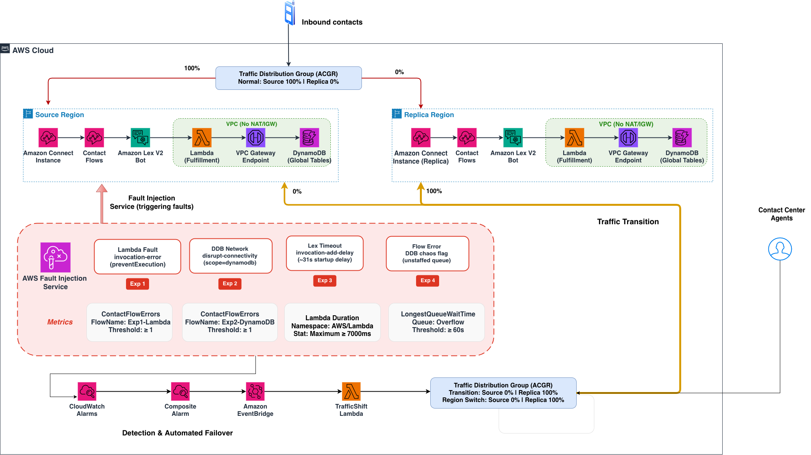

# Amazon Connect Chaos Engineering with FIS and ACGR Traffic Transition

Inject controlled faults into a live Amazon Connect contact centre with **AWS Fault Injection
Service (FIS)**, watch CloudWatch attribute the failure to the component that broke, and verify
that **Amazon Connect Global Resiliency (ACGR)** shifts telephony traffic to the replica Region —
where the call is still answered.

> **Requires AWS Enterprise Support (or AWS Unified Operations).** ACGR is onboarded through your AWS account team. This
> sample assumes you already have an ACGR-paired Connect instance and a Traffic Distribution
> Group with a phone number attached.

> ### ⚠️ Non-production sample — deploy into a dedicated AWS account
>
> The FIS execution role can create, modify, delete and re-associate network ACLs on **any VPC in
> the account you deploy into**, not just the one this stack creates. FIS builds the cloned ACL at
> run time, so no ARN can be scoped in advance. A mis-targeted experiment can sever connectivity
> for unrelated workloads in the same account — the blast radius is the account, so the account is
> the isolation boundary.
>
> Every FIS experiment here carries a bounded duration and a stop condition on its own alarm, so
> disruption is time-limited and self-reverting. That limits duration, not scope.
>
> **This sample is not cleared for production.** Several security findings are accepted
> specifically because this is a demonstration in a throwaway account — no real customer data, an
> operator present for every experiment, and time-limited faults (Experiment 4's flag is the
> exception and must be turned off by hand). None of those assumptions hold in production.
>
> Before any production use, work through
> [Security posture and production hardening](#security-posture-and-production-hardening) below.

**This file explains what the sample is, how it works, and how to install it.**
**[RUNBOOK.md](RUNBOOK.md) is the procedure for running the experiments** — every test command,
what to press on the keypad, what you should hear, and what to check afterwards. Install from
here, test from there.

---

## Contents

- [Why chaos-test a contact centre](#why-chaos-test-a-contact-centre)
- [What FIS contributes](#what-fis-contributes)
- [Architecture](#architecture)
- [The four experiments](#the-four-experiments)
- [Why you must wait before calling](#why-you-must-wait-before-calling-experiments-1-and-3)
- [Detection and traffic transition](#detection-and-traffic-transition)
- [Why traffic transition is deliberately delayed](#why-traffic-transition-is-deliberately-delayed)
- [Prerequisites](#prerequisites)
- [Installation](#installation)
- [Parameters](#parameters)
- [Resources deployed](#resources-deployed)
- [Monitoring](#monitoring)
- [Synthetic traffic generator](#synthetic-traffic-generator-optional)
- [Cost](#cost)
- [Security posture and production hardening](#security-posture-and-production-hardening)
- [Cleanup](#cleanup)
- [Key design decisions](#key-design-decisions)
- [Repository layout and tooling](#repository-layout-and-tooling)

---

## Why chaos-test a contact centre

A contact centre fails differently from a web service. There is no retry button, no page
refresh, and no error page to read. A caller gets silence, a wrong prompt, or a hold that never
ends — and every second of it is a person waiting on a phone line. Worse, the failures that hurt
most are rarely Amazon Connect itself. They are the things Connect calls out to: a Lambda that
throws, a database it cannot reach, a code hook that answers too slowly to matter, a queue with
nobody in it.

Those dependencies are exactly what a runbook review cannot test. You can read the architecture
diagram and still not know:

- whether a broken account-lookup Lambda produces a **metric that names the Lambda**, or just a
  generic "flow error" indistinguishable from four other causes;
- whether your alarm thresholds can actually fire on the volume a single test call produces;
- whether failing over to the replica Region **helps**, or whether the replica Region is quietly
  reaching back into the Region you just declared unhealthy;
- whether the replica Region can answer a call at all.

None of these is visible to `cfn-lint`, to a successful CloudFormation deployment, or to alarms
reporting `OK`. Each needs a real fault and a real phone call.

That is the argument for chaos engineering here. You are not testing whether AWS works. You are
testing whether **your detection and your traffic transition work**, and the only way to know is to break
something on purpose while someone is on the line.

---

## What FIS contributes

FIS is what makes the fault **controlled, repeatable, and safe to run against a live instance**.
Without it you would be reduced to breaking things by hand — revoking an IAM permission,
commenting out code, dropping a table — which is slow, hard to undo, and impossible to run the
same way twice.

FIS gives four things this sample depends on:

| What FIS provides | Why it matters here |
|---|---|
| **Managed fault actions** | `aws:lambda:invocation-error` and `aws:lambda:invocation-add-delay` break a Lambda *from outside*, with no change to your handler code (the FIS extension layer is attached to the target function). |
| **A defined blast radius** | Targets are explicit ARNs. Experiment 1 errors one named function; it cannot spread to any other function. |
| **Automatic expiry** | Each FIS experiment (1–3) carries a duration (`PT5M`). If you walk away, the fault removes itself. Experiment 4 is a data flag and does not expire. |
| **Stop conditions** | Every experiment is bound to **its own** detection alarm. The moment the alarm fires, FIS halts the experiment — the fault stops as soon as it has proven the point. |

Two consequences of the stop-condition design are worth knowing up front:

- **Traffic transition still happens** when FIS stops the experiment. The alarm, EventBridge and the
  traffic shift are independent of FIS; halting the fault does not undo the detection.
- **A stop-condition alarm that is already in `ALARM` stops the experiment as it starts.** This is
  why the runbook's reset step waits for alarms to clear before you start the next experiment.

Experiments 1, 2 and 3 are FIS experiments. **Experiment 4 is not** — it is a data flag, because
the fault being modelled is a bad configuration value rather than an infrastructure failure.

---

## Architecture



Example Regions are shown; yours are set by `SOURCE_REGION` and `REPLICA_REGION`.

```
                        ┌──────────────────────────────────┐
                        │  Traffic Distribution Group      │
                        │           (ACGR)                 │
                        │  normal:   IAD 100% | PDX 0%     │
                        │  transitioned: IAD 0% | PDX 100% │
                        └───────────────┬──────────────────┘
                                        │
             ┌──────────────────────────┴──────────────────────────┐
       SOURCE (us-east-1)                              REPLICA (us-west-2)
       ┌──────────────────────┐                    ┌──────────────────────┐
       │ Connect instance     │                    │ Connect instance     │
       │  (same instance id) ─┼── ACGR replicates ►│  (same instance id)  │
       │ 5 contact flows ─────┼───────────────────►│ 5 contact flows      │
       │        │             │                    │        │             │
       │        ▼             │                    │        ▼             │
       │ Lex V2 bot ──────────┼──── Lex GR ───────►│ Lex V2 bot (same id) │
       │        │             │                    │        │             │
       │        ▼             │                    │        ▼             │
       │ AccountLookup        │                    │ AccountLookup        │
       │ CallLogger           │  same names, per   │ CallLogger           │
       │ LexFulfillmentHandler│  Region deploys    │ LexFulfillmentHandler│
       │        │             │                    │        │             │
       │        ▼             │                    │        ▼             │
       │ DynamoDB ────────────┼── global tables ──►│ DynamoDB (replica)   │
       │ Overflow queue ──────┼──── ACGR ─────────►│ Overflow queue       │
       └──────────────────────┘                    └──────────────────────┘
                    │                                        │
              4 alarms → composite → EventBridge → TrafficShiftHandler
                                        │
                                        ▼
                         UpdateTrafficDistribution (ACGR)
```

**One entry point.** The phone number stays associated with **`ConnectChaos-Menu`** for all four
experiments; you never re-point it. Every call announces the serving Region, then offers a DTMF
menu. The digit you press selects which experiment's flow runs.

Two details in that diagram carry more weight than they look like they do:

- **The Lambda and Lex ARNs inside the flows use the ACGR runtime token `$.AwsRegion`.** ACGR
  replicates flow content *verbatim*, so a hardcoded Region makes the replica Region invoke the
  **source's** Lambda and Lex bot. Traffic moves, metrics look correct, and the "healthy" Region
  is still entirely dependent on the failed one.
- **Both Regions run their own `TrafficShiftHandler`, and each shifts traffic away from itself.**
  There is no central controller to become a single point of failure. The handler reads the
  current distribution first and no-ops if traffic has already moved, so both Regions alarming at
  once cannot fight each other.

---

## The four experiments

| # | DTMF | Component broken | How it is broken | Attributing metric | Outcome you should observe |
|:-:|:----:|---|---|---|---|
| **1** | `1` | `ConnectChaos-AccountLookup` Lambda | FIS `aws:lambda:invocation-error` (`preventExecution=true`) | `ContactFlowErrors` on `ConnectChaos-Exp1-Lambda` (AWS/Connect) | Flow takes its `InvokeLambdaFunction` Error branch; alarm fires; traffic shifts |
| **2** | `2` | DynamoDB reachability | FIS `aws:network:disrupt-connectivity` (`scope=dynamodb`) on both Lambda subnets | `ContactFlowErrors` on `ConnectChaos-Exp2-DynamoDB` (AWS/Connect) | The audit write fails; flow takes its Error branch; alarm fires; traffic shifts |
| **3** | `3` | `LexFulfillmentHandler` code hook | FIS `aws:lambda:invocation-add-delay` (~31 s startup delay) | `Duration` Maximum (AWS/Lambda) | Code hook runs slow but returns cleanly; `Duration` ≈ 31,000 ms with `Errors` = 0. Lex waits only 30 s for a code hook by default, so it gives up first and the flow plays its error message |
| **4** | `4` | Contact flow configuration | A DynamoDB chaos flag, **not** FIS | `LongestQueueWaitTime` on `ConnectChaos-Overflow` (AWS/Connect) | Contact is parked on a queue no agent can receive; queue wait climbs past 60 s |

### How each experiment stays distinguishable

[`ContactFlowErrors`](https://docs.aws.amazon.com/connect/latest/adminguide/monitoring-cloudwatch.html)
counts the number of times a flow's error branch ran, and is dimensioned by `ContactFlowName`.
Each experiment therefore gets **its own contact flow**, which turns that one metric into
independent per-experiment signals with no metric math and no overlap. Three of the four alarms
are Connect-native as a result.

Three supporting decisions make the attribution hold:

- **The call logger appears in exactly one flow.** If every flow invoked it, an Experiment 2
  fault would raise `ContactFlowErrors` on all four `ContactFlowName` dimensions at once and
  destroy the attribution this design exists to create.
- **Every flow announces `"Connected in region $.AwsRegion"`** before anything else, so which
  Region served the call is *audible* rather than something you reconstruct from two log groups
  afterwards.
- **Every failure path has its own prompt**, naming the experiment, so the caller experience
  identifies the fault; a test run against the wrong experiment is easy to spot.

**Account numbers are keyed on the keypad (DTMF) wherever possible.** The menu and Experiment 1
use keypad digits, which removes speech recognition as a variable, so a wrong result points at the
lookup rather than at how the number was transcribed. Experiments 3 and 4 hand the call to an
Amazon Lex bot, so there you say one short phrase ("I want to look up my account") and then key
the account number.

> **On cascades — read this before you judge a result.** Every fault here ultimately flows
> through a Lambda, so `AWS/Lambda Errors` also rises during Experiments 1 and 2 (Experiment 3's
> function returns successfully, so its `Errors` stays at 0). That is inherent to a synchronous
> IVR call path, not a defect. The composite alarm ORs all four
> component alarms, so traffic transition happens regardless. When demonstrating a *specific* experiment,
> watch **that experiment's own alarm**, never the composite.

### Experiment 1 — the account-lookup Lambda fails

`ConnectChaos-Exp1-Lambda` collects a 5-digit account number as DTMF, then invokes
`ConnectChaos-AccountLookup` **directly**. FIS marks that invocation failed without running the
code, so the flow takes the block's Error branch.

- **Caller hears:** *"The account lookup service is unavailable. This is experiment one."*
- **Alarm:** `ConnectChaos-Exp1-Lambda-{region}`, threshold `ContactFlowErrorsThreshold`
  (default `0`, so a single flow error trips it)
- A wrong or missing account number does **not** error. The Lambda returns `NOT_FOUND` or
  `INVALID_INPUT` and the flow branches on it with a `Compare` block, so a mistyped number can
  never masquerade as an injected fault.
- **Needs about a minute to arm** — see [below](#why-you-must-wait-before-calling-experiments-1-and-3).
- **Why this fault:** it shows that a function can be failed from outside its code, and that the
  per-flow metric names the flow that broke.
- **Outcome:** the alarm fires, the composite alarm follows, traffic shifts to the replica Region,
  and the recovery call (same digit) is answered there.

### Experiment 2 — DynamoDB is unreachable

FIS blocks both Lambda subnets from the DynamoDB endpoint at the network ACL.
`ConnectChaos-Exp2-DynamoDB` invokes `ConnectChaos-CallLogger` directly — a genuine audit write —
so the DynamoDB failure takes the flow's Error branch.

- **Caller hears:** *"We could not record your call. This is experiment two."*
- **Alarm:** `ConnectChaos-Exp2-DynamoDB-{region}`, threshold `ContactFlowErrorsThreshold`
- **No arming delay.** It is network-level, so the DynamoDB path is severed for the whole
  experiment. **With no arming delay, it is a good one to run first.**
- **Why this fault:** it shows that a healthy function can fail because of what it depends on. The
  audit write is the only DynamoDB-dependent step in the flow, so the failure is attributable.
- **Outcome:** the alarm fires, the composite alarm follows, traffic shifts to the replica Region,
  and the recovery call (same digit) is answered there, using the replica's own network path to
  DynamoDB.

### Experiment 3 — the Lex code hook becomes too slow to be useful

FIS injects a ~31 s startup delay while the function's own timeout is 40 s, so the code hook runs
slow but still returns cleanly: from the function's side it is latency, not an error. Amazon Lex
is less patient than the function. It
[waits 30 seconds for a code hook by default](https://docs.aws.amazon.com/lexv2/latest/dg/context-mgmt-session-attribs.html),
which is less than the injected delay, so Lex gives up first and the flow takes its error branch.

- **Caller hears:** a long pause, then
  *"The lookup service is taking too long. This is experiment three."* The flow plays that same
  line for any problem in the Lex block, including a phrase Lex does not recognise, so hearing it
  straight away means the Lex block did not get usable input, not that the fault is active.
- **Alarm:** `ConnectChaos-Exp3-Latency-{region}`, threshold `LexCodeHookLatencyThresholdMs`
  (default 7000 ms)
- **The only experiment not alarmed on a Connect metric, deliberately.** It is a *latency* fault:
  the function succeeds, so `AWS/Lambda Errors` stays at 0, and the flow's error branch just plays
  a message, so error metrics, including the flow-error metric, may stay flat. The dashboard's
  observation-only `ContactFlowErrors` panel for this flow lets you check. The injected delay
  raises the function's `Duration` directly, so a latency threshold is the measurement that
  matches the fault.
- **Needs about a minute to arm**, as with Experiment 1.
- **Outcome:** the `Duration` alarm fires, the composite alarm follows, traffic shifts to the
  replica Region, and the recovery call (same digit) is answered there by its own Lex bot and its
  own copy of the code hook.

### Experiment 4 — a bad config value parks the caller on an unstaffed queue

When the lookup works, the caller is served by self-service: the flow confirms the account and the
call ends, with no queue involved. When the lookup fails, the flow falls back to the agent queue.
A DynamoDB chaos flag makes the fulfillment Lambda return `Failed` to Lex.
`ConnectChaos-Exp4-Queue` routes the failure path to **`ConnectChaos-Overflow`** — a queue
referenced by **no routing profile**, so no agent can ever receive its contacts — and transfers
the contact there. It waits indefinitely and `LongestQueueWaitTime` climbs. A bad configuration
value therefore turns self-service failures into a growing queue.

- **Caller hears:** *"All agents are currently busy. Please hold. This is experiment four."*
  The flow sends any problem in the Lex block to the same queue, so a phrase Lex does not
  recognise also parks the caller there with the flag off. The `LexFulfillmentHandler` log shows
  whether the flag was read as enabled.
- **Alarm:** `ConnectChaos-Exp4-Queue-{region}`, threshold `QueueWaitSecondsThreshold`
  (default 60 s)
- **Not a FIS experiment.** You toggle a DynamoDB item. It does **not** expire on its own — you
  must turn it off.
- **Why not `MissedCalls`?** That metric requires a call to be *offered to an agent* and go
  unanswered for 20 s, which is not reproducible without a staffed agent deliberately not
  answering. An unstaffed queue removes the human from the test entirely.
- **The signal is accumulated queue wait, not a count**, so the caller has to stay on the line.
  The 60 s clock starts at the hold prompt, not when you dial. Exact timing is in the runbook.
- **Outcome:** the queue-wait alarm fires once the caller has waited past the threshold, the
  composite alarm follows, and traffic shifts to the replica Region. With the flag off, the
  recovery call there is served by self-service and ends.

**The flag is Region-scoped (`chaos_flag#<region>`) on purpose, and this is the most important
lesson in the sample.** The config table is a DynamoDB Global Table. A single shared key would
replicate the fault to the replica Region, and traffic transition could never recover: the caller would land
in a Region reading the same broken row and queueing into the same unstaffed queue. The alarms
would fire correctly and traffic would move, and the customer would still be broken. The runbook
arms the source Region's key only, so it shows the working case; the failing case is what the
quote below describes.

> **A dependency failure that lives in replicated data is not a regional failure, and no amount
> of traffic shifting will fix it.**

Multi-Region architectures can fail this way — a poisoned config row, a bad feature flag, a
corrupt cache entry, a schema migration. All replicate faithfully to the standby, which is the
one thing you did not want replicated. Do not "simplify" the flag back to a single shared key.

**Why shift traffic at all?** If Region A cannot serve callers, they do not have to wait there.
Shifting the traffic distribution group sends new calls to Region B, and with Global Resiliency
you can also
[distribute your agents across both Regions](https://docs.aws.amazon.com/connect/latest/adminguide/overview-agent-distribution.html),
so agents who are signed in can receive those calls. This sample has no agents by design, so the
recovery call is handled by self-service and ends. In a real deployment, a caller who needs an
agent would join a queue in Region B and be answered there.

**The proof that matters.** Moving traffic to a Region that cannot answer is not resilience.
Besides the recovery call after each experiment, the runbook has an explicit check that does not
depend on any experiment: shift traffic by hand, place a call, and confirm that the replica
Region's `ConnectChaos-AccountLookup` logged it and the source Region's did not. See
[the runbook's proof](RUNBOOK.md#the-proof-that-matters--a-call-answered-in-the-replica-region).

---

## Why you must wait before calling (Experiments 1 and 3)

**Start the experiment, wait about a minute, then call.** Calling immediately is an easy way to
conclude an experiment is broken — the invocation runs normally, you hear *"Welcome
back, John Doe"*, and nothing is wrong except the timing. It is the easiest mistake
to make.

Experiments 1 and 3 apply their fault through the **AWS FIS Lambda extension**, a layer attached
to the target function. The extension does not receive a push notification. It polls S3 for the
fault configuration on its own schedule, and until that poll completes the function behaves
completely normally.

That polling has to happen *inside* a Lambda invocation. AWS notes that a function which runs for
less than the extension's average poll time (about 70 ms) may need several invocations to obtain
the fault configuration, and recommends `AWS_FIS_POLL_MAX_WAIT_MILLISECONDS` for that case
([FIS Lambda actions](https://docs.aws.amazon.com/fis/latest/userguide/use-lambda-actions.html)).
This sample sets two environment variables on the target functions:

```yaml
AWS_FIS_POLL_MAX_WAIT_MILLISECONDS: '3000'   # wait for an in-flight poll before the function runs
AWS_FIS_SLOW_POLL_INTERVAL_SECONDS: '20'     # AWS default is 60; a lower value polls more often
```

AWS documents a ramp-up of up to 60 seconds before a fault affects all invocations, so after
`start-experiment` give it about a minute. The fault then stays applied until the experiment ends
(`FISExperimentDuration`, default `PT5M`).

An experiment's stop condition is a CloudWatch alarm, so an alarm that is already in `ALARM` stops
the experiment as it starts.

**Experiment 2 needs no wait** — it is network-level, so it has no extension ramp-up, and it stays
applied for the whole experiment. **Experiment 4 needs no wait** — the flag is read on the next call.

---

## Detection and traffic transition

```
any component alarm → composite alarm ALARM
  → EventBridge rule
    → TrafficShiftHandler
      → hold for RegionSwitchDelaySeconds        (default 120 s)
        → re-check the triggering alarm is STILL in ALARM
          → UpdateTrafficDistribution:  this Region 0%  /  other Region 100%
```

New inbound calls then route to the replica Region. **Calls already in progress are not moved** —
ACGR shifts telephony traffic, it does not migrate live contacts.

**Recovery is deliberately manual.** Alarms returning to `OK` shift nothing back; the handler
ignores `OK` events by design, so an operator confirms the fault is genuinely resolved before
customers are routed back. The runbook's reset step does this.

## Why traffic transition is deliberately delayed

`RegionSwitchDelaySeconds` (default **120**, maximum 600) holds the traffic shift after the alarm
fires. Setting it to `0` shifts immediately.

The delay exists because **shifting an entire contact centre's telephony is not free**: calls
in progress stay where they are, agents in the replica Region pick up the load, and a transient
blip is not worth that disruption. A short dwell is a crude but genuine form of flap damping, and
the handler re-checks that the alarm is still in `ALARM` before it acts.

**What you can hear during the dwell.** Each FIS experiment's own alarm is also its stop
condition, so FIS ends the fault at about the moment the alarm fires. Do not expect to hear the
failure during the dwell in Experiments 1–3. In Experiment 4 the flag stays set until you turn it
off, so the broken Region stays broken throughout the dwell.

One behaviour the dwell introduced, and how it is handled: a sleeping handler could **undo
a reset.** If you reset traffic to 100/0 while a handler was still in its dwell, it would wake up
and shift traffic away again. To prevent that, the handler **re-reads the
triggering alarm after the dwell and abandons the traffic transition if it is no longer in `ALARM`.**
Two consequences:

- **`aws cloudwatch set-alarm-state` can no longer test traffic transition while a dwell is configured.** A
  forced alarm state is a temporary override that CloudWatch reverts at the alarm's next
  evaluation, so it can expire inside the 120 s dwell, in which case the handler correctly declines to act. To test the mechanism alone,
  redeploy with `REGION_SWITCH_DELAY_SECONDS=0`.
- **If you reset while a handler is dwelling and the alarm is genuinely still in `ALARM`, the
  shift still lands** after the dwell. Wait out the dwell before resetting, or reset again after the
  dwell has elapsed.

---

## Prerequisites

1. **AWS Enterprise Support** (or AWS Unified Operations) — required to onboard ACGR.
2. **ACGR-paired Connect instance**, SAML 2.0 enabled. The replica has the **same instance ID**
   in both Regions; that is how you recognise an ACGR pair.
3. **Traffic Distribution Group** with a phone number attached. A number claimed to the TDG is
   enough for this sample; for production telephony failover AWS's
   [ACGR requirements](https://docs.aws.amazon.com/connect/latest/adminguide/connect-global-resiliency-requirements.html)
   say to port the numbers you want to be multi-Region.
4. **A supported Region pair:** `us-east-1`↔`us-west-2` or `eu-west-2`↔`eu-central-1`. The
   template's `Rules` block also accepts `ap-northeast-1`→`ap-northeast-3`, but **this sample
   does not support that pair**: Lex Global Resiliency is not available there and the flows are
   not wired for per-Region bots (see the Tokyo/Osaka note under Installation, Step 2).
5. **Tooling:** `git`, `make`, `zip` and `python3`; AWS CLI v2 with credentials that can create
   the resources below; and `cfn-lint` if you intend to run `make lint`.
6. **Permission to create a service-linked role.** Lex Global Resiliency creates
   `AWSServiceRoleForLexV2Replication` when a bot is first replicated in the account, so the
   principal that enables replication needs permission to create service-linked roles (the
   [Lex GR docs](https://docs.aws.amazon.com/lexv2/latest/dg/navigation-gr.html) point to the
   `AmazonLexFullAccess` managed policy).
7. **No other copy of this sample in the same Region.** The Lambda functions, contact flows, queue,
   Lex bot, IAM roles and alarms have fixed names (ACGR requires identical Lambda names in both
   Regions), so deploy **one copy per Region per account**. A second copy, even under a different
   stack name, fails with an "already exists" error. DynamoDB global table names are also unique
   across the whole account, so use a stack name that no other deployment in the account has used
   in any Region.

**You do NOT need to pre-create** a VPC, subnets, a security group, an S3 bucket, or the FIS
extension layer ARN. All are created or auto-resolved. Lambda functions needing identical names
across Regions and flows avoiding hardcoded Regions are both handled by the template.

The runbook's pre-flight step gives you the exact commands to confirm items 2, 3 and 4 before you
deploy anything.

---

## Installation

The **only deployable artifact is `cfn/main-template.yaml`.** It deploys **twice** — once per
Region — and the `IsSourceRegion` condition controls what goes where. The global tables, all
five contact flows, the overflow queue and its hours of operation are created only in the source
Region and replicated by ACGR and DynamoDB.

### Step 1 — clone the repository and set your environment

```bash
git clone https://github.com/aws-samples/sample-chaos-engineering-in-amazon-connect-customer-global-resiliency.git
cd sample-chaos-engineering-in-amazon-connect-customer-global-resiliency
```

You supply **two** values to install; the rest are derived. Both are UUIDs. The
[RUNBOOK](RUNBOOK.md#step-0--shell-variables) adds a third, `PHONE`, for testing:

| Variable | What it is | Example (not a real value) | How to find yours |
|---|---|---|---|
| `INSTANCE_ID` | Connect instance ID. An ACGR replica shares the **same** ID in both Regions, which is how you recognise a pair | `EXAMPLE1-2222-3333-4444-555555555555` | `aws connect list-instances --region <SOURCE_REGION>` |
| `TDG_ID` | The Traffic Distribution Group that the traffic shift updates | `EXAMPLE2-6666-7777-8888-999999999999` | `aws connect list-traffic-distribution-groups --region <SOURCE_REGION>` |

```bash
export STACK=connect-chaos-sample
export SOURCE_REGION=us-east-1
export REPLICA_REGION=us-west-2
export ACCT=$(aws sts get-caller-identity --query Account --output text)

# REPLACE both — the values below only show the expected shape.
export INSTANCE_ID=EXAMPLE1-2222-3333-4444-555555555555
export TDG_ID=EXAMPLE2-6666-7777-8888-999999999999

# An ACGR replica shares the SAME instance id, so the two ARNs differ only by Region.
export SOURCE_INSTANCE_ARN=arn:aws:connect:$SOURCE_REGION:$ACCT:instance/$INSTANCE_ID
export REPLICA_INSTANCE_ARN=arn:aws:connect:$REPLICA_REGION:$ACCT:instance/$INSTANCE_ID
```

`EXAMPLE…` is not valid hexadecimal, so a UUID still containing it has not been replaced —
[RUNBOOK Step 0](RUNBOOK.md#step-0--shell-variables) has a guard that fails on exactly that.

### Step 2 — deploy both Regions

```bash
# Creates the code bucket, zips and uploads the Lambdas, deploys the source Region,
# reads the Lex GR bot/alias ids from its outputs, then deploys the replica Region.
make deploy-pair STACK=$STACK \
  SOURCE_REGION=$SOURCE_REGION REPLICA_REGION=$REPLICA_REGION \
  SOURCE_INSTANCE_ARN=$SOURCE_INSTANCE_ARN \
  REPLICA_INSTANCE_ARN=$REPLICA_INSTANCE_ARN \
  TDG_ID=$TDG_ID
```

`deploy-pair` creates the code bucket, zips and uploads the Lambdas, deploys the source Region,
reads the Lex GR bot and alias IDs from its outputs, then deploys the replica Region with those
IDs.

**Both stacks must be left standing.** The replica Region cannot answer a call without its own
Lambdas, and showing that it can is the point of the sample.

<details>
<summary>Deploying one Region at a time</summary>

```bash
# Deploy ONE Region. Run it again for the replica Region, adding the replicated Lex ids.
make deploy STACK=$STACK REGION=$SOURCE_REGION \
  CONNECT_INSTANCE_ARN=$SOURCE_INSTANCE_ARN \
  CONNECT_INSTANCE_ID=$INSTANCE_ID TDG_ID=$TDG_ID
```

Then read `LexBotId` and `LexBotAliasId` from the source stack outputs and pass them to the
replica Region as `REPLICATED_LEX_BOT_ID` and `REPLICATED_LEX_BOT_ALIAS_ID`.

**Deploying by hand.** The template is larger than CloudFormation's 51,200-byte limit for an inline
template body, so stage it through S3 and pass `--template-url` instead of `--template-body`.
`make deploy` does this for you.

**Tokyo/Osaka is not supported by this sample.**
[Lex Global Resiliency](https://docs.aws.amazon.com/lexv2/latest/dg/navigation-gr.html) currently
works only with the US East/US West and London/Frankfurt pairs. Without it the bot IDs differ per
Region, so the replicated flows would still point at the source Region's bot and the replica could
not serve a call.
</details>

### Step 3 — the things CloudFormation cannot do

```bash
# The steps CloudFormation cannot do: seed the tables, associate the phone number with
# ConnectChaos-Menu, wire the replicated Lex alias into the replica instance, and reset
# traffic to 100% source. Idempotent, safe to re-run.
make post-deploy STACK=$STACK \
  SOURCE_REGION=$SOURCE_REGION REPLICA_REGION=$REPLICA_REGION \
  INSTANCE_ID=$INSTANCE_ID TDG_ID=$TDG_ID
```

`post-deploy` is idempotent and safe to re-run. It performs all four:

| Step | Why CloudFormation cannot do it |
|---|---|
| Seed the DynamoDB tables (customer `12345`, chaos flag off in **both** Regions) | Data, not infrastructure |
| **Associate the phone number with `ConnectChaos-Menu`** | The number belongs to the TDG, not the stack, and no CloudFormation resource models the number → flow link |
| Wait for the Lex **alias** replica to be `Available`, then associate it with the **replica** Connect instance (skipped when the stack was deployed with `EnableLexGlobalResiliency=false`) | `LexBotAssociation` is created in the source Region only; the replica instance needs the replicated alias associated before its flows can reach Lex (`make verify` checks this) |
| Reset traffic to 100% source / 0% replica | Live routing state |

> **⚠️ Skipping the association is easy to miss.** Every resource reports `CREATE_COMPLETE` and
> every alarm in this sample reports `OK`, but calls never enter the flow. Amazon Connect counts
> such calls in its `MisconfiguredPhoneNumbers` metric, which this sample does not alarm on.
> `make verify` checks the link with `aws connect list-flow-associations --resource-type
> VOICE_PHONE_NUMBER`. That proves the association exists; the baseline call in the runbook is
> still the only proof that the call is answered.

### Step 4 — verify before spending any phone calls

```bash
# Checks both Regions. Must exit 0 before you place a single test call.
make verify STACK=$STACK SOURCE_REGION=$SOURCE_REGION \
  REPLICA_REGION=$REPLICA_REGION TDG_ID=$TDG_ID
```

Checks across both Regions: stack status, whether the replica Region can actually serve a call,
Lex replication, the `$.AwsRegion` tokens in all five flows, seed data, the traffic split, the
alarms, the phone number → `ConnectChaos-Menu` association, and a smoke invoke of the
traffic-shift handler. It must exit `0` before you test.

> **⚠️ Lex GR needs the ALIAS replica, not just the bot replica.** The flow resolves
> `arn:aws:lex:$.AwsRegion:…:bot-alias/<botId>/<aliasId>` to the **alias**, so the replica Region
> cannot serve a call until the *alias* replica reports `Available`.
> `make verify` checks the alias replica and the replica instance's Lex association directly, rather
> than relying on the `Replication` property of `AWS::Lex::Bot`.

**Now go to [RUNBOOK.md](RUNBOOK.md)** for the baseline call and the four experiments.

---

## Parameters

| Parameter | Required | Default | Notes |
|-----------|:---:|---|---|
| `ConnectInstanceArn` | ✓ | — | ACGR instance ARN for **this** Region |
| `ConnectInstanceId` | ✓ | — | Instance UUID for **this** Region (the same value in both Regions of an ACGR pair) |
| `TrafficDistributionGroupId` | ✓ | — | The TDG that the traffic shift updates |
| `LambdaCodeBucket` | ✓ | — | Bucket holding the Lambda zips, in **this** Region; `make` creates and fills it |
| `SourceRegion` | | `us-east-1` | The Region where flows, queue and global tables are created. Must form an ACGR pair with `ReplicaRegion` |
| `ReplicaRegion` | | `us-west-2` | The replica Region of the pair |
| `EnableAutoRegionSwitch` | | `false` | Deploy the EventBridge rule and `TrafficShiftHandler` (`make deploy` sets `true`) |
| `RegionSwitchDelaySeconds` | | `120` | Hold the traffic shift this long after the alarm. 0–600; `0` shifts immediately |
| `CreateVpc` | | `true` | Create the VPC, two private subnets and free DynamoDB/S3 gateway endpoints |
| `VpcCidr` | | `10.20.0.0/16` | Only when `CreateVpc=true` |
| `SubnetACidr` | | `10.20.1.0/24` | Only when `CreateVpc=true` |
| `SubnetBCidr` | | `10.20.2.0/24` | Only when `CreateVpc=true` |
| `LambdaSubnetIdA` | | `''` | **Only when `CreateVpc=false`.** A Rule requires all three of A, B and the security group |
| `LambdaSubnetIdB` | | `''` | Only when `CreateVpc=false` |
| `LambdaSecurityGroupId` | | `''` | Only when `CreateVpc=false` |
| `FISExtensionLayerArn` | | *SSM path* | Auto-resolves per Region from the public SSM parameter. Override only to pin a version |
| `LambdaCodeVersion` | | `v1` | Part of every function's S3 key. `make deploy` supplies a content hash of `lambda/*.py` so a code change always updates the functions |
| `ContactFlowErrorsThreshold` | | `0` | Exps 1 and 2. `0` means one flow error trips the alarm. Raise for production monitoring |
| `LexCodeHookLatencyThresholdMs` | | `7000` | Exp 3, on Lambda `Duration` Maximum |
| `QueueWaitSecondsThreshold` | | `60` | Exp 4, on `LongestQueueWaitTime` |
| `FISExperimentDuration` | | `PT5M` | ISO-8601 |
| `EnableTrafficGenerator` | | `false` | Synthetic metrics — drive alarms without phone calls (`make deploy` sets `true`) |
| `EnableLexGlobalResiliency` | | `true` | Replicate the bot via Lex GR (us-east-1↔us-west-2 and eu-west-2↔eu-central-1 only) |
| `ReplicatedLexBotId` | | `''` | Replica Region only; the `LexBotId` output of the source stack |
| `ReplicatedLexBotAliasId` | | `''` | Replica Region only; the `LexBotAliasId` output of the source stack |
| `DashboardType` | | `regional` | `regional`, or `unified` for one cross-Region dashboard in the source Region |
| `ReplicaConnectInstanceId` | | `''` | Source Region only, when `DashboardType=unified` |

**`make deploy` overrides some defaults.** It passes `EnableAutoRegionSwitch=true` and
`EnableTrafficGenerator=true`, and fills `LambdaCodeVersion` itself. Override them with the
matching `make` variables: `ENABLE_AUTO_REGION_SWITCH`, `ENABLE_TRAFFIC_GEN`, `ENABLE_LEX_GR`,
`DASHBOARD_TYPE`, `CREATE_VPC`, `CONTACT_FLOW_ERRORS_THRESHOLD`, `REGION_SWITCH_DELAY_SECONDS`,
and `LAMBDA_SUBNET_A` / `LAMBDA_SUBNET_B` / `LAMBDA_SG` when `CREATE_VPC=false`.

---

## Resources deployed

| Resource | Source | Replica | How |
|----------|:---:|:---:|---|
| VPC, 2 private subnets, route table, SG | ✓ | ✓ | Created when `CreateVpc=true` (default) |
| Gateway endpoints — DynamoDB + S3 | ✓ | ✓ | Free. **S3 is required by the FIS extension** |
| Contact flows ×5 — `Menu` + one per experiment | ✓ | ✓ | Created in source, ACGR replicates |
| Queue `ConnectChaos-Overflow` + 24×7 hours | ✓ | ✓ | Created in source, ACGR replicates |
| Lex V2 bot + version + alias | ✓ | ✓ | Source creates; Lex GR replicates (same IDs) |
| Connect ↔ Lex `IntegrationAssociation` | ✓ | via `post-deploy` | Created by the template in the source only; `make post-deploy` associates the replicated alias with the replica instance |
| `LexFulfillmentHandler` (40 s timeout, VPC, FIS layer) | ✓ | ✓ | Same name in both Regions — an ACGR requirement |
| `ConnectChaos-CallLogger` (VPC) | ✓ | ✓ | Invoked directly by the Exp 2 flow |
| `ConnectChaos-AccountLookup` (VPC, FIS layer) | ✓ | ✓ | Invoked directly by the Exp 1 flow |
| `ConnectChaos-TrafficShiftHandler` (no VPC) | ✓ | ✓ | Requires `EnableAutoRegionSwitch=true` |
| DynamoDB global tables ×3 | ✓ | ✓ | Created in source, auto-replicated |
| S3 — FIS config bucket (`ccfis-…`) | ✓ | ✓ | Per Region |
| FIS experiment templates ×3 | ✓ | ✓ | Per Region. Exp 4 is not a FIS experiment |
| CloudWatch alarms ×4 + composite | ✓ | ✓ | Per Region |
| EventBridge rule `ConnectChaos-RegionSwitch-{region}` | ✓ | ✓ | Requires `EnableAutoRegionSwitch=true`. Composite alarm → `TrafficShiftHandler` |
| `ConnectChaos-TrafficGenerator-{region}` + EventBridge schedule `ConnectChaos-TrafficGen-Schedule-{region}` | ✓ | ✓ | Requires `EnableTrafficGenerator=true`; the schedule is deployed **disabled** |
| Dashboard | ✓ | ✓ | `regional` or `unified` |
| IAM roles (one per function, plus the Lex bot role and the FIS execution role) | ✓ | ✓ | Per Region |

**No NAT gateway and no internet gateway are created.** Only DynamoDB and S3 reachability is
needed and gateway endpoints for both are free, so the VPC adds **$0**. S3 is not optional: the
FIS extension reads its fault config from S3, and without an S3 route Experiments 1 and 3
cannot read their fault configuration, so no fault is applied. This is the easiest thing to get wrong when bringing your own
VPC with `CreateVpc=false`.

---

## Monitoring

Dashboard **`ConnectChaos-{region}`**, one panel per experiment:

| Panel | Metric | Statistic |
|---|---|---|
| Exp 1 | `ContactFlowErrors` on `ConnectChaos-Exp1-Lambda` | Sum |
| Exp 2 | `ContactFlowErrors` on `ConnectChaos-Exp2-DynamoDB` | Sum |
| Exp 3 | `LexFulfillmentHandler` `Duration` | Maximum (ms) |
| Exp 4 | `LongestQueueWaitTime` on `ConnectChaos-Overflow` | Maximum (sec) |

Two further panels are **observation-only**: `ContactFlowErrors` for the Exp 3 flow, and
`AWS/Lambda` `Errors` for `ConnectChaos-AccountLookup`, `ConnectChaos-CallLogger` and
`LexFulfillmentHandler`. Neither is alarmed. Experiment 3 is alarmed on `Duration` rather than on
flow errors — see [Experiment 3](#experiment-3--the-lex-code-hook-becomes-too-slow-to-be-useful).

**Metrics to watch per experiment.** The alarmed metric is the one that trips the alarm. The
supporting metrics help you read what happened. The metric definitions are in the
[Amazon Connect](https://docs.aws.amazon.com/connect/latest/adminguide/monitoring-cloudwatch.html)
and [Lambda](https://docs.aws.amazon.com/lambda/latest/dg/monitoring-metrics-types.html) references.

| Experiment | Alarmed metric | Supporting metrics |
|---|---|---|
| 1 | `ContactFlowErrors` on `ConnectChaos-Exp1-Lambda` | Lambda `Errors` on `ConnectChaos-AccountLookup`. Connect retries a failed invocation up to three times, so one call can add several |
| 2 | `ContactFlowErrors` on `ConnectChaos-Exp2-DynamoDB` | Lambda `Errors` on `ConnectChaos-CallLogger` |
| 3 | `Duration` Maximum on `LexFulfillmentHandler` | Lambda `Errors` stays at 0; Lambda `Invocations` shows the call reached the function; `ContactFlowErrors` for the Exp 3 flow may stay flat |
| 4 | `LongestQueueWaitTime` on `ConnectChaos-Overflow` | `QueueSize` on the same queue; Lambda `Errors` on `LexFulfillmentHandler` stays at 0, because the function returns `Failed` to Lex instead of throwing |
| All | The composite alarm | The `TrafficShiftHandler` log line `Traffic shifted: …` |

**There is no SNS topic**, because nothing would be subscribed to it. Traffic transition does not
depend on one — that path is composite alarm → EventBridge → `TrafficShiftHandler`.

---

## Synthetic traffic generator (optional)

`make deploy` deploys `ConnectChaos-TrafficGenerator-{region}` by default
(`EnableTrafficGenerator=true`; the template default is `false`), plus a **disabled** EventBridge
schedule. It lets you exercise the alarm → composite alarm → EventBridge → `TrafficShiftHandler`
chain **without placing phone calls**. **None of the four experiments uses it**; it is an optional
tool for testing that chain on its own.

```bash
GEN=ConnectChaos-TrafficGenerator-$SOURCE_REGION

# AWS CLI v2 needs --cli-binary-format for a raw JSON payload, otherwise it fails with
# "Invalid base64".
aws lambda invoke --function-name $GEN --region $SOURCE_REGION \
  --cli-binary-format raw-in-base64-out \
  --payload '{"mode":"healthy","count":10}' /dev/stdout

# faults: lambda | dynamodb | lex | flow | all
aws lambda invoke --function-name $GEN --region $SOURCE_REGION \
  --cli-binary-format raw-in-base64-out \
  --payload '{"mode":"faulty","fault_type":"dynamodb","count":10}' /dev/stdout
```

The schedule `ConnectChaos-TrafficGen-Schedule-{region}` is deployed **disabled**. To run the
generator continuously, enable it, and disable it again when you are finished:

```bash
aws events enable-rule  --name ConnectChaos-TrafficGen-Schedule-$SOURCE_REGION --region $SOURCE_REGION
aws events disable-rule --name ConnectChaos-TrafficGen-Schedule-$SOURCE_REGION --region $SOURCE_REGION
```

Each fault type publishes a datapoint with the namespace, name and dimensions that one
experiment's alarm watches, so the alarm reacts to it. AWS advises against publishing to
namespaces that begin with `AWS/`
([PutMetricData](https://docs.aws.amazon.com/AmazonCloudWatch/latest/APIReference/API_PutMetricData.html));
this optional tool does so deliberately, in a dedicated account:

| `fault_type` | Emits | Trips |
|---|---|---|
| `lambda` | `AWS/Connect` `ContactFlowErrors`, `ContactFlowName=ConnectChaos-Exp1-Lambda` | Exp 1 alarm |
| `dynamodb` | `AWS/Connect` `ContactFlowErrors`, `ContactFlowName=ConnectChaos-Exp2-DynamoDB` | Exp 2 alarm |
| `lex` | `AWS/Lambda` `Duration` ≈ 31 s on `LexFulfillmentHandler` | Exp 3 alarm |
| `flow` | `AWS/Connect` `LongestQueueWaitTime` on `ConnectChaos-Overflow` | Exp 4 alarm |
| `all` | all of the above | every alarm, and the composite |

> **⚠ Two limits.** Synthetic points can be mistaken for real ones on your dashboard, so
> keep the schedule disabled except while you are using it. And the generator never runs a
> contact flow, so it **cannot substitute for a real call**: it proves the alarm → traffic shift
> chain, but not that a flow takes its Error branch or that a fault is attributed to the right
> component.
> `ContactFlowErrors` and `LongestQueueWaitTime` are only produced by Connect for real contacts.

---

## Cost

This sample deploys billable AWS services. Prices differ by Region and pricing plan and change over
time, so this README quotes none. Use the official pricing pages:

| Service | What drives the cost | Pricing |
|---------|----------------------|---------|
| Amazon Connect | Voice usage and telephony for your test calls, the phone number, and any Global Resiliency usage charges that apply to your plan | [Amazon Connect pricing](https://aws.amazon.com/connect/pricing/) |
| AWS FIS | The action-minutes while an experiment runs | [AWS FIS pricing](https://aws.amazon.com/fis/pricing/) |
| Amazon Lex | Requests made during testing; check whether your Connect pricing plan includes them | [Amazon Lex pricing](https://aws.amazon.com/lex/pricing/) |
| Amazon CloudWatch | Alarms (standard and composite) and dashboards | [Amazon CloudWatch pricing](https://aws.amazon.com/cloudwatch/pricing/) |
| Lambda, DynamoDB, S3 | Small request and storage volumes | [Lambda](https://aws.amazon.com/lambda/pricing/), [DynamoDB](https://aws.amazon.com/dynamodb/pricing/) and [S3](https://aws.amazon.com/s3/pricing/) pricing |
| VPC | The sample uses gateway endpoints and creates no NAT gateway | [Amazon VPC pricing](https://aws.amazon.com/vpc/pricing/) |

The alarms, dashboards and phone number keep billing while they exist, so follow
[Cleanup](#cleanup) when you finish. The traffic-generator schedule is deployed disabled; if you
enable it, remember to disable it again.

---

## Security posture and production hardening

### Controls in place

- Every FIS experiment has a **stop condition** bound to its own alarm and a bounded duration
  (`FISExperimentDuration`, default `PT5M`), so any fault is time-limited and self-reverting.
- The created VPC has **no internet gateway and no NAT** — only free gateway endpoints to
  DynamoDB and S3, so Lambda egress has no route off the VPC.
- The FIS config bucket is encrypted at rest and blocks all four categories of public access.
  Access is granted through identity policies on the FIS and Lambda execution roles; the template
  adds no bucket policy, so any principal in the account that already holds S3 permissions (for
  example an administrator) can reach it too, and TLS-only access is not enforced.
- No credentials, keys or deployment-specific identifiers are committed. `make lint` runs
  `scripts/scan-secrets.py`, which fails the build on account IDs, phone numbers, instance and
  TDG UUIDs, VPC and subnet IDs, access keys and private keys.
- Experiment 4's chaos flag does **not** expire. `make reset` disarms it in both Regions and
  `make verify` fails if the replica Region is still armed.

### Accepted for this sample — and what each one assumes

Static analysis findings are suppressed in the template with a written reason on each resource
(`Metadata.cfn_nag.rules_to_suppress` and `Metadata.checkov.skip`). Each was justified against the
threat model of **a sample in a dedicated non-production account**: regenerable demo data, no real
customers, an operator present for every run, and time-limited faults. Those assumptions
are what make the reasoning valid, and **none of them hold in production**.

| Accepted | The assumption it rests on |
|---|---|
| The FIS role holds the EC2 network-ACL actions (create, delete, replace association and related) on `Resource: '*'` | The account contains nothing a mis-targeted experiment must not reach |
| Security group has no explicit egress rule | There is no NAT and no internet gateway, so egress has no route. Add either and the control disappears |
| No Dead Letter Queue on the traffic transition path | An operator is watching each run, so a dropped event shows up immediately as "traffic did not shift" |
| No DynamoDB point-in-time recovery, deletion protection or customer-managed key | The data is demo fixtures, recreated by `make post-deploy` in seconds |
| No reserved concurrency | Untested against real call volume; a cap would throttle and drop live calls |
| No VPC flow logs, S3 access logging or versioning | Forensics and auditability are not required for a demo |
| The handlers log the full Connect event, including the caller's phone number, and their log groups (created by Lambda, not by this stack) have no retention period and are not removed when the stack is deleted | Every test call comes from the operator's own phone, in a dedicated account |
| No actions on any alarm (no SNS, no paging) | The traffic shift is driven by EventBridge reacting to the composite alarm's state change, not by an alarm action, and an operator is watching each run |
| Permissions are inline policies on seven single-purpose IAM roles (the Lambda roles also attach AWS's managed basic-execution and VPC-access policies) | Each role is created by this stack and none is shared, so customer-managed policies would add objects without reuse |
| No S3 Object Lock on the FIS config bucket | It holds only transient fault-configuration objects that FIS writes and deletes during an experiment; there is nothing to protect from deletion |
| Scanners report the FIS config bucket as publicly readable or writable (`S3_BUCKET_NO_PUBLIC_RW_ACL`) — a **false positive** | The template sets no ACL, so the owner-only default applies, and all four public-access-block settings are `true` |
| Bandit B603/B607 on the `git` calls in `scripts/scan-secrets.py` | Fixed argument lists, no shell, local developer tool; annotated `# nosec` in the script |
| The traffic generator's role (deployed by `make deploy`; the template default is off) may publish metrics into the `AWS/Lambda`, `AWS/Connect` and `AWS/Lex` namespaces with any dimensions | The account holds no other workload whose alarms or dashboards could be misled. Set `EnableTrafficGenerator=false` to omit it |
| The trust policy of every IAM role has no `aws:SourceAccount` / `aws:SourceArn` condition, and the Lex permission on the fulfillment Lambda is limited by `SourceAccount` only (any Lex bot in the account can invoke it) | The account contains no other bots or principals that should be kept away from these roles and functions |
| The Lex bot role may call `polly:SynthesizeSpeech`, and the FIS and traffic-shift roles may call `cloudwatch:DescribeAlarms` (needed to read composite alarms), on `Resource: '*'` | Read and synthesis calls only, in a dedicated account |
| The IVR gives no caller authentication: any caller who keys a valid account number hears that customer's name | The only customer record is a fictitious one seeded by `make post-deploy` |

### Hardening required before production

| # | Change | Priority | After the change |
|:-:|---|---|---|
| 1 | Scope the FIS network policy to this stack's VPC, and gate the destructive NACL verbs on the `managedByFIS=true` tag FIS applies to the ACL it clones | **Highest** | Experiment 2, live call |
| 2 | Add explicit `SecurityGroupEgress` limited to the DynamoDB and S3 gateway-endpoint prefix lists | High | Experiments 1–3, live call each |
| 3 | Add an SQS DLQ on the EventBridge rule target, plus an alarm on its depth | High | `make verify` (confirms nothing broke) |
| 4 | Enable DynamoDB PITR on all three tables | Medium | `make verify` (confirms nothing broke) |
| 5 | Enable VPC flow logs | Medium | `make verify` (confirms nothing broke) |
| 6 | Add S3 access logging and versioning — **and update cleanup to delete object versions**, or stack deletion will fail | Medium | Cleanup dry run |
| 7 | Re-evaluate reserved concurrency against real call volume | Low | Load test |
| 8 | Stop logging whole events and caller numbers (`call_logger.py`, `account_lookup.py`, `lex_fulfillment_handler.py`), create the log groups in the template with a retention period, and consider a CloudWatch Logs data protection policy | Medium | A live call, then read the log |
| 9 | Deploy with `EnableTrafficGenerator=false`, or remove the generator and its role, in any account that holds other workloads | Medium | `make verify` |
| 10 | Authenticate callers before the flow returns customer data, and replace the seed customer with a real data source | **Highest** for any real data | A live call |
| 11 | Add `aws:SourceAccount` / `aws:SourceArn` conditions to the role trust policies, a `SourceArn` to the Lex invoke permission, and a bucket policy that denies non-TLS requests | Low | `make verify`, then Experiments 1–3 |

`make verify` confirms the sample still works after a change; it does not check for these controls.
Items 3 and 4 are the cheap wins: additive, no existing code path touched, and checkable without a
phone call. Items 1 and 2 change the network path the faults depend on, so getting either wrong
makes the experiments silently stop working while still looking healthy — each needs a real call to
confirm.

Beyond this list, production use needs a security review against your own organisation's controls,
and chaos testing against a production contact centre additionally needs blast-radius planning, a
rollback plan, and agreement from whoever owns the customer-facing service.

---

## Cleanup

> **Empty the FIS config buckets first.** CloudFormation cannot delete a non-empty bucket and the
> stack will hit `DELETE_FAILED`.

```bash
for R in $REPLICA_REGION $SOURCE_REGION; do
  aws s3 rm "s3://ccfis-${ACCT}-${R}-${STACK}/" --recursive --region $R
done

# delete REPLICA first, then SOURCE
aws cloudformation delete-stack --stack-name $STACK --region $REPLICA_REGION
aws cloudformation wait stack-delete-complete --stack-name $STACK --region $REPLICA_REGION
aws cloudformation delete-stack --stack-name $STACK --region $SOURCE_REGION
aws cloudformation wait stack-delete-complete --stack-name $STACK --region $SOURCE_REGION

# optional: Lambda's log groups. Lambda creates them, not this stack, so they outlive it and
# hold the caller numbers from your test calls. Delete them if you do not want to keep them.
# for R in $REPLICA_REGION $SOURCE_REGION; do
#   for G in LexFulfillmentHandler ConnectChaos-CallLogger ConnectChaos-AccountLookup \
#            ConnectChaos-TrafficShiftHandler ConnectChaos-TrafficGenerator-$R; do
#     aws logs delete-log-group --log-group-name /aws/lambda/$G --region $R 2>/dev/null
#   done
# done

# optional: the code/staging buckets. `make deploy` creates one in EACH Region, so remove both.
# for R in $REPLICA_REGION $SOURCE_REGION; do
#   aws s3 rb "s3://connect-chaos-code-${ACCT}-${R}" --force --region $R
# done
```

Replica before source, because the DynamoDB global tables are owned by the source stack.

---

## Key design decisions

| Decision | Rationale |
|----------|-----------|
| One contact flow per experiment | `ContactFlowErrors` counts a flow's error-branch runs and is dimensioned by `ContactFlowName`, which gives per-experiment attribution without metric math |
| An attributing metric per experiment, not fault isolation | All faults also raise `Lambda Errors`; only each experiment's own metric names the cause |
| Exp 1 targets the account-lookup Lambda, not the Lex code hook | Erroring the code hook would only raise `AWS/Lambda Errors`, which Exp 3 also touches, destroying attribution |
| Exp 2 invokes a call logger directly from the flow | Otherwise `ContactFlowErrors` never fired and Exp 2 only rode the Lambda-Errors alarm |
| Exp 3 uses Lambda `Duration`, not `ContactFlowErrors` | A latency fault does not make the function fail, so error metrics may stay flat; `Duration` rises directly |
| Exp 4 uses a no-agent queue + `LongestQueueWaitTime` | `MissedCalls` needs a staffed agent to deliberately not answer — not reproducible by a reader |
| Exp 4's chaos flag is Region-scoped | A Global Table would replicate the fault to the standby, making traffic transition incapable of recovering |
| Explicit `IntegrationAssociation` (template for the source, `post-deploy` for the replica) | A Lex bot must be associated with the instance before a flow can invoke it |
| `CreateVpc=true` with free gateway endpoints | Removes the VPC prerequisite at no cost. S3 reachability is mandatory — the FIS extension reads its config from S3 |
| FIS layer ARN resolved from public SSM | Both the publishing account **and** the version differ per Region, so a hand-copied ARN is a common source of error |
| Lambda S3 key includes a code content hash | A fixed key made CloudFormation skip code updates and ship stale Lambdas while reporting success |
| Composite alarm has an explicit `DependsOn` | The rule names children in a `!Sub` literal, so CloudFormation cannot infer the dependency and creation races |

---

## Repository layout and tooling

| Path | Purpose |
|---|---|
| **`cfn/main-template.yaml`** | **The only deployable artifact.** Deployed once per Region |
| `lambda/*.py` | Function source; zipped and uploaded by `make`. Source of truth for the code |
| `contact-flows/*.json` | **Generated** reference copies — not deployed. Live flows are inline in the template |
| `scripts/extract-flows.py` | Regenerates the reference JSON and validates flow structure |
| `scripts/scan-secrets.py` | Fails the build on any committed credential or deployment-specific identifier |
| `scripts/check-docs.py` | Fails the build when the README, RUNBOOK, template and code drift apart (parameter table, links, resource names, `make` targets, shell blocks, generator vs alarms) |
| `docs/` | Architecture diagram |
| `RUNBOOK.md` | The test procedure |

```bash
make help                          # list every target
make bucket   REGION=...           # create the code/staging bucket (idempotent)
make package                       # zip the Lambdas
make bootstrap REGION=...          # bucket + package + upload
make deploy      STACK=... REGION=... CONNECT_INSTANCE_ARN=... CONNECT_INSTANCE_ID=... TDG_ID=...
make deploy-pair STACK=... SOURCE_REGION=... REPLICA_REGION=... \
                 SOURCE_INSTANCE_ARN=... REPLICA_INSTANCE_ARN=... TDG_ID=...
make post-deploy STACK=... SOURCE_REGION=... REPLICA_REGION=... INSTANCE_ID=... TDG_ID=...
make verify      STACK=... SOURCE_REGION=... REPLICA_REGION=... TDG_ID=...
make reset       STACK=... SOURCE_REGION=... REPLICA_REGION=... TDG_ID=...   # see RUNBOOK Step R
make flows                         # regenerate contact-flows/*.json from the template
make lint                          # cfn-lint, py_compile, JSON, flow drift, docs consistency, secrets
make history-scan                  # scan every commit on every ref for identifiers
make clean
```

### Checks before you commit

Run `make lint` before committing. It also scans for deployment-specific values; see
[CONTRIBUTING](CONTRIBUTING.md#before-you-commit).

## License

MIT-0. See [LICENSE](LICENSE).
